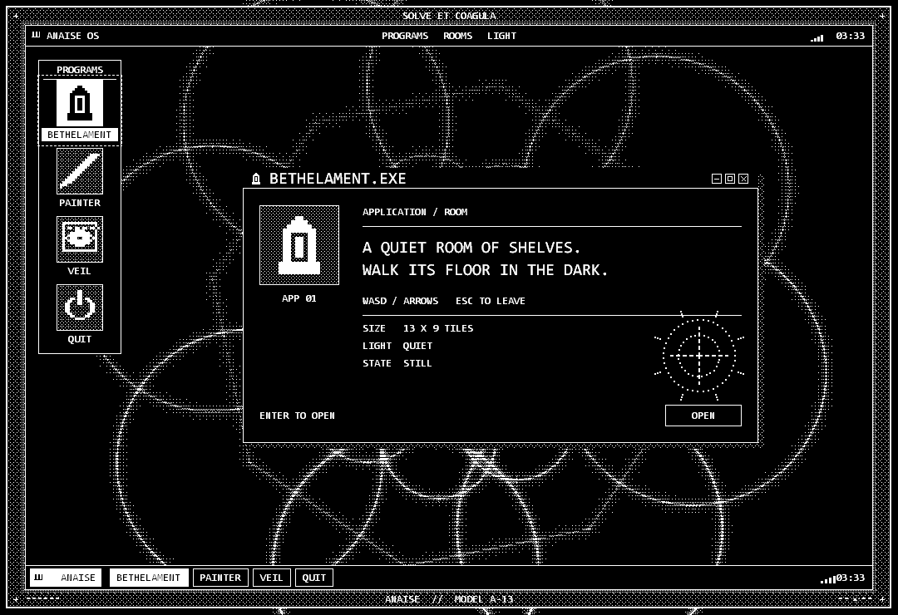
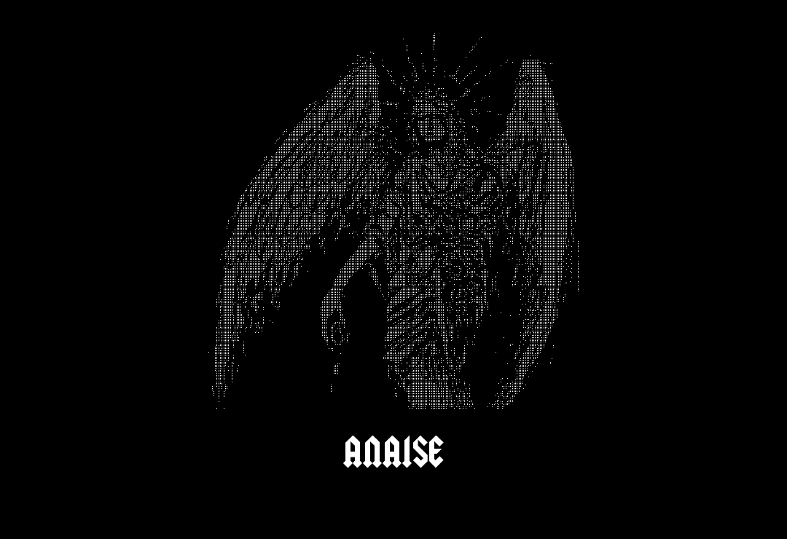
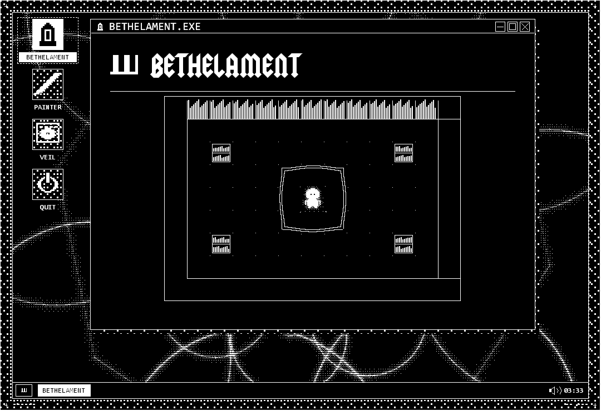
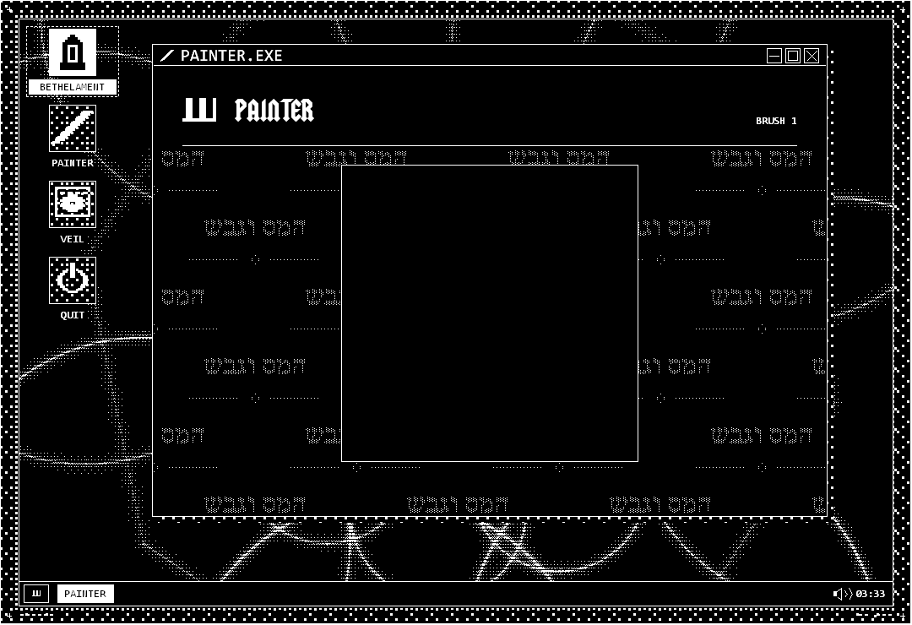
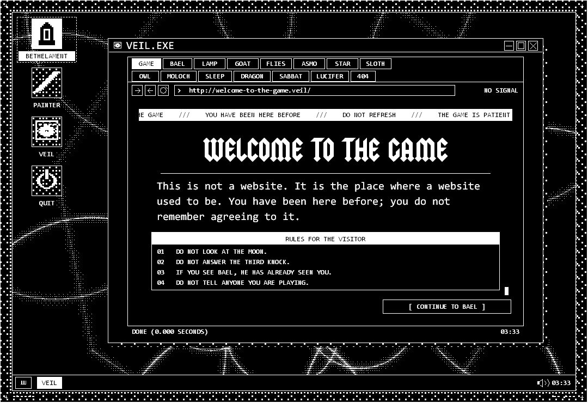

# Anaise

A small black-and-white game library in a native Windows window. Anaise opens
on a dot-art seraphim startup screen, then a monochrome computer desktop with
three apps to open: Bethelament, a Painter canvas and Veil, a browser that only
reaches dead cult pages.

The palette is strictly black and white, the logo is 10x10 pixel art, and
nothing is written to disk.

## Screenshots

The desktop, captured directly from the app at 1080 x 740 with no apps open.
The app captures show each program inside its own window:



| Startup seraphim | Bethelament |
| --- | --- |
|  |  |
| **Painter** | **Veil** |
|  |  |

These are offscreen captures at virtual time `4200` ms. To regenerate them,
render into `build/readme`, then re-encode the PNGs losslessly into
`docs/screenshots`; the renderer writes uncompressed files, so the checked-in
copies are re-encoded only to keep the repository small:

```bat
powershell -ExecutionPolicy Bypass -File tools\headless.ps1 -Screen all -OutDir build\readme
```

## Text art

The bookshelf logo and the pilgrim's standing sprite use these exact ASCII
rows in `src/main.cpp`: `#` is a lit pixel and `.` is empty space.

Bookshelf:

```text
..........
.##..##..#
.##..##..#
.##..##..#
.##..##..#
.##..##..#
.##..##..#
##########
..........
..........
```

Pilgrim:

```text
.....####.....
...########...
..##########..
.############.
.############.
.####.##.####.
.############.
.############.
..##########..
....######....
...########...
##############
#.##########.#
#.##########.#
#.##########.#
..##########..
...###..###...
...##....##...
```

<details>
<summary>Seraphim source art (Unicode Braille)</summary>

The original text from `src/angel_art.h`; the splash turns each raised
Braille dot into a point of light.

```text
⠀⠀⠀⠀⠀⠀⠀⠀⠀⠀⠀⠀⠀⠀⠀⠀⠀⠀⠀⠀⠀⠀⠀⠀⠀⠀⠀⠀⠀⠀⠀⠀⠀⠀⠀⠀⠀⠀⠀⠀⠀⠀⠀⠀⠀⠀⠀⠀⠀⠀⠀⠀⠀⠀⠀⠀⠀⠀⠀⠀⡀⠀⠀⠀⠀⠀⠀⠀⠀⢾⠀⠀⠀⠀⠀⠀⠀⠀⠀⠀⠀⠀⠀⡠⠀⠀⠀⠀⠀⠀⠀⠀⠀⠀⠀⠀⠀⠀⠀⠀⠀⠀⠀⠀⠀⠀⠀⠀⠀⠀⠀⠀⠀⠀
⠀⠀⠀⠀⠀⠀⠀⠀⠀⠀⠀⠀⠀⠀⠀⠀⠀⠀⠀⠀⠀⠀⠀⠀⠀⠀⠀⠀⠀⠀⠀⠀⠀⠀⠀⠀⠀⠀⠀⠀⠀⠀⠀⠀⠀⠀⠀⠀⠀⠀⠀⠀⠀⠀⠀⠀⠀⠀⠀⠀⠀⡀⠀⠀⠀⠀⠀⠀⠀⠿⠀⠀⠀⠀⠀⠀⠀⠀⠀⠀⠀⠀⠄⠀⠀⠀⠀⠀⠀⠀⠀⠀⠀⠀⠀⠀⠀⠀⠀⠀⠀⠀⠀⠀⠀⠀⠀⠀⠀⠀⠀⠀⠀⠀
⠀⠀⠀⠀⠀⠀⠀⠀⠀⠀⠀⠀⠀⠀⠀⠀⠀⠀⠀⠀⠀⠀⠀⠀⠀⠀⠀⠀⠀⠀⠀⠀⠀⠀⠀⠀⠀⠀⠀⠀⠀⠀⠀⠀⠀⠀⠀⠀⠀⠀⣀⠀⠀⠀⠀⠀⠀⠀⠀⠀⠀⠇⠀⠀⠀⠀⠀⠀⠀⠃⠀⠀⠀⠀⠀⠀⠀⠀⠀⠀⡠⠋⠀⠀⠀⠀⠀⠀⠀⠀⠀⠀⠀⠀⠀⠀⠀⠀⠀⠀⠀⠀⠀⠀⠀⠀⠀⠀⠀⠀⠀⠀⠀⠀
⠀⠀⠀⠀⠀⠀⠀⠀⠀⠀⠀⠀⠀⠀⠀⠀⠀⠀⠀⠀⠀⠀⠀⠀⠀⠀⠀⠀⠀⠀⠀⠀⠀⠀⠀⠀⠀⠀⠀⠀⠀⠀⠀⠀⠀⠀⠒⠤⠄⠀⡀⠁⠀⠀⠀⠀⠀⠀⠀⠀⠀⢠⠀⠀⠀⠈⠀⠀⠀⢀⠀⠀⠀⠀⠀⠀⠀⠀⠀⠄⠀⠀⠀⠀⠀⠀⠀⠀⠀⠀⠀⠀⠀⠀⠀⠀⠀⠀⠐⠀⠀⠀⠀⠀⠀⠀⠀⠀⠀⠀⠀⠀⠀⠀
⠀⠀⠀⠀⠀⠀⠀⠀⠀⠀⠀⠀⠀⠀⠀⠀⠀⠀⠀⠀⠀⠀⠀⠀⠀⠀⠀⠀⠀⠀⠀⠀⠀⠀⠀⠀⠀⠀⠀⠀⠀⠀⠀⡀⠠⠤⠅⠡⡴⡁⣥⠀⠀⢈⠀⠀⠀⠀⠀⠀⠀⠈⠢⠀⠀⠀⡄⠀⠀⠈⠁⠀⠀⠀⠀⠀⠀⠀⠀⠀⠀⠀⠀⠀⠀⠀⠀⠀⠀⢀⠀⠊⠀⠂⠀⠀⣼⣿⣿⣿⣿⡓⠰⠄⠠⠄⠀⠀⠀⠀⠀⠀⠀⠀
⠀⠀⠀⠀⠀⠀⠀⠀⠀⠀⠀⠀⠀⠀⠀⠀⠀⠀⠀⠀⠀⠀⠀⠀⠀⠀⠀⠀⠀⠀⠀⠀⠀⠀⠀⠀⠀⠀⠀⠀⠀⠀⠀⢀⠀⣶⠾⣭⣥⣿⣿⣷⠀⠀⠁⢄⢀⠀⠀⠀⠀⠀⠀⢱⠀⠀⢣⠀⠀⣒⠁⠀⢀⠀⠀⠀⡰⠁⠀⠀⢀⠠⠁⠀⠀⠀⢀⠀⠀⠀⠀⠀⠀⠀⠀⣰⢛⣿⣿⣿⣿⣿⣔⠀⠀⠀⠀⠀⠀⠀⠀⠀⠀⠀
⠀⠀⠀⠀⠀⠀⠀⠀⠀⠀⠀⠀⠀⠀⠀⠀⠀⠀⠀⠀⠀⠀⠀⠀⠀⠀⠀⠀⠀⠀⠀⠀⠀⠀⠀⠀⠀⠀⠀⠀⠀⠄⣠⣶⢮⢴⣾⣿⣿⣿⣿⣿⠢⠀⠀⠈⠢⠀⠀⠀⢤⠀⠘⠠⢇⠀⠀⠀⠀⠂⠀⠀⠠⠀⠆⣖⡁⠀⢀⠔⠉⠀⠀⠀⠀⠂⠁⠀⠀⠀⠀⠀⠀⠀⢀⢣⠾⢫⠹⣿⣿⣿⣿⣆⠀⠀⠀⠀⠀⠀⠀⠀⠀⠀
⠀⠀⠀⠀⠀⠀⠀⠀⠀⠀⠀⠀⠀⠀⠀⠀⠀⠀⠀⠀⠀⠀⠀⠀⠀⠀⠀⠀⠀⠀⠀⠀⠀⠀⠀⠀⠀⠀⠀⠀⣨⣾⡿⡡⢴⣿⣿⣿⣿⡿⣿⣿⡷⠀⠀⠀⠈⢇⠀⠠⠀⠁⠀⠘⠁⠀⠀⠠⠀⢀⠀⠀⠀⠀⠀⠀⠃⠔⠁⠀⠀⢀⠤⠂⠀⠀⠀⠀⠀⠀⠀⠀⠀⠀⢂⣆⢖⣥⡶⡜⣿⣿⣿⣿⡄⠁⠀⠀⠀⠀⠀⠀⠀⠀
⠀⠀⠀⠀⠀⠀⠀⠀⠀⠀⠀⠀⠀⠀⠀⠀⠀⠀⠀⠀⠀⠀⠀⠀⠀⠀⠀⠀⠀⠀⠀⠀⠀⠀⠀⠀⠀⡠⠄⣺⣿⣯⠚⣤⡟⢙⣿⣿⣰⣼⣿⣿⡇⠀⠀⠀⠀⠀⠀⠿⣰⠀⡀⠁⠀⡀⡨⢠⣄⠀⡰⠒⠂⠀⠀⠀⠀⠀⠀⣢⡄⠀⠀⠀⠀⠀⠀⠀⠀⠀⠀⠀⠀⠀⡜⣴⡿⣧⢏⢺⣿⣿⣿⣿⣷⡀⠀⠀⠀⠀⠀⠀⠀⠀
⠀⠀⠀⠀⠀⠀⠀⠀⠀⠀⠀⠀⠀⠀⠀⠀⠀⠀⠀⠀⠀⠀⠀⠀⠀⠀⠀⠀⠀⠀⠀⠀⠀⠀⠀⠀⠠⢈⣺⣿⣿⣷⣵⠏⣀⢪⣿⣿⢸⢼⢸⣿⡇⠀⠀⠀⠀⠀⠀⠀⠁⠀⠐⣀⡈⡨⢘⣛⣤⡤⠃⠲⡥⠆⠀⠀⠀⠠⠞⠓⠀⠀⠀⠀⣀⠀⠄⠀⠀⠀⠀⠀⠀⠈⣼⣿⡽⣫⢯⣿⣿⣿⡿⣿⣿⣧⠀⠀⠀⠀⠀⠀⠀⠀
⠀⠀⠀⠀⠀⠀⠀⠀⠀⠀⠀⠀⠀⠀⠀⠀⠀⠀⠀⠀⠀⠀⠀⠀⠀⠀⠀⠀⠀⠀⠀⢀⡠⢔⠄⠈⣠⣿⣿⣿⣿⣽⠋⣨⠦⣿⣿⣿⡁⣼⠈⢿⣷⠄⠤⣦⣤⢄⡤⠀⠀⠈⠀⠈⣛⢛⣉⣖⣠⠂⢫⣥⣦⣄⢡⡍⠁⠀⠀⠀⠀⠐⠀⠈⠀⠀⠀⠀⠀⠀⠀⠀⠀⢈⡄⣿⣽⣫⣿⣿⣿⣿⣇⡝⢿⣿⢤⠀⠀⠀⠀⠀⠀⠀
⠀⠀⠀⠀⠀⠀⠀⠀⠀⠀⠀⠀⠀⠀⠀⠀⠀⠀⠀⠀⠀⠀⠀⠀⠀⠀⠀⠀⠀⠀⡴⠊⡰⠣⣪⣾⣿⠿⢿⣷⢋⡝⢁⣵⣿⡿⣽⡟⢑⣣⢰⣿⣿⡄⠀⠀⠀⠀⠃⠀⠀⠀⠀⡻⣧⠻⣿⣿⣿⣷⣄⠶⠬⣍⠀⠞⢀⠀⠀⠀⢠⠠⡄⠀⠀⢀⣀⠀⠀⠀⠀⠀⠀⣾⣀⣿⢡⡏⣿⣿⣿⣿⡇⢸⣿⣿⡆⠀⠀⠀⠀⠀⠀⠀
⠀⠀⠀⠀⠀⠀⠀⠀⠀⠀⠀⠀⠀⠀⠀⠀⠀⠀⠀⠀⠀⠀⠀⠀⠀⠀⠀⠀⠀⠀⣠⢟⢽⣵⣿⣿⡟⢸⡿⠃⢚⣴⡞⣿⠏⡇⡿⢃⢀⢲⣾⣿⡿⢃⠀⠀⠀⠀⠀⠀⢈⠁⠘⡙⠰⠾⠛⣉⠁⠭⠉⠉⠹⠀⡶⡀⠘⢀⠀⠀⠈⠂⠀⠁⠀⠀⠀⠀⠀⠒⠀⢠⣾⡏⣼⣿⡸⠀⣿⣿⣿⣿⣿⠸⣿⣿⣿⠀⠀⠀⠀⠀⠀⠀
⠀⠀⠀⠀⠀⠀⠀⠀⠀⠀⠀⠀⠀⠀⠀⠀⠀⠀⠀⠀⠀⠀⠀⠀⠀⠀⠀⠀⣠⣰⣷⣽⣿⣿⣿⠟⢡⣌⣵⣿⣿⣿⣇⡏⡄⣷⠃⠾⢙⡤⡿⣿⡓⠀⠀⠀⠁⠀⠃⠀⠀⢠⠘⠀⢰⣶⣾⣿⠐⣿⣿⣂⠂⢩⣿⠌⠄⠺⠥⠀⠀⠀⠀⠀⠀⠀⠀⠀⠀⠀⠀⣴⣿⡞⣿⣿⣷⣦⡛⢛⣿⣿⣿⢦⢻⣿⣿⣧⠀⠀⠀⠀⠀⠀
⠀⠀⠀⠀⠀⠀⠀⠀⠀⠀⠀⠀⠀⠀⠀⠀⠀⠀⠀⠀⠀⠀⠀⠀⣠⠀⢀⣶⣿⣿⣿⡿⠛⣿⠿⢢⣿⣿⣿⡿⠿⣿⣻⢱⣧⢟⡀⢁⡬⢁⣃⡜⠁⠪⠖⠑⣀⠀⠀⠀⠀⠎⠃⡄⠈⣿⣿⣏⣈⣼⣷⣿⣆⢈⠿⡸⠌⢠⡉⠀⠀⠋⢦⠀⠀⠀⠀⠀⠀⠀⠀⣰⣿⣿⢿⣿⣿⣿⣿⡏⢻⣿⣿⢸⡞⣿⣿⣿⡆⠀⠀⠀⠀⠀
⠀⠀⠀⠀⠀⠀⠀⠀⠀⠀⠀⠀⠀⠀⠀⠀⠀⠀⠀⠀⠀⠀⢀⠘⠀⣰⣿⣿⣿⠟⢁⣤⡾⢃⣴⣶⠋⣿⡟⡀⣸⢁⣣⢾⡏⣲⢨⣼⡿⠟⠉⡊⠁⢢⠦⠀⠀⢀⠀⠀⠀⠐⣀⣶⡀⠘⢟⡥⣤⣝⣿⣿⠃⠀⣿⡖⠇⠁⢠⠁⠀⠀⠀⠀⠀⠀⢀⠀⠀⢢⢺⣿⣫⣿⢸⠃⣿⠃⣿⡇⣼⠏⣿⡸⣿⢸⣿⣿⣷⡀⠀⠀⠀⠀
⠀⠀⠀⠀⠀⠀⠀⠀⠀⠀⠀⠀⠀⠀⠀⠀⠀⠀⠀⠀⠀⠔⠁⢠⣾⣿⣿⡿⡣⣨⡾⡋⡡⢫⢎⡏⢶⣿⡽⡱⣣⣿⡟⣱⠀⣿⢸⡇⡇⣬⡖⡅⠐⠋⠀⠂⠆⠠⠁⠀⠀⠂⠡⠋⢧⠀⠈⠛⠛⠉⠉⠁⠀⠤⡇⣻⡜⢁⠹⡉⠀⠠⠀⠀⠀⠀⠀⡀⢡⣶⡟⡡⢹⠇⠞⠈⡿⠀⠛⠁⠘⠠⢻⡇⣿⡏⣿⣿⢩⣷⠀⠀⠀⠀
⠀⠀⠀⠀⠀⠀⠀⠀⠀⠀⠀⠀⠀⠀⠀⠀⠀⠀⠀⠀⠀⠀⣴⣿⣿⣿⠋⢠⣾⢟⠅⣞⣱⡇⣼⠇⡾⢈⣭⠶⣿⣿⢸⡏⡖⣿⠟⣥⡇⡿⣱⠓⠃⢉⠀⠐⠚⢄⡀⠀⠀⠀⠀⢁⡀⠀⠀⠀⢴⢀⣤⠀⢐⣔⡝⠘⠅⠂⠄⣡⣥⡄⠐⢆⠀⠠⢊⠀⠋⡜⣱⡫⠛⣂⣰⣦⡥⠠⣾⡩⢰⠀⣸⣧⢻⡗⣿⣿⡎⣿⣇⠀⠀⠀
⠀⠀⠀⠀⠀⠀⠀⠀⠀⠀⠀⠀⠀⠀⠀⠀⠀⠀⣠⠀⢤⣾⣿⣿⠟⢁⣵⣿⠃⣪⣾⠛⡿⢠⡿⡸⣑⣿⠃⣣⡿⣣⣿⠘⣾⠟⣾⣿⢸⠱⢁⡕⢃⠂⡑⠃⠀⠈⠈⠓⢀⠠⠞⢈⡘⠠⠀⠀⣚⡎⣿⡳⣸⡜⣎⣠⢃⠂⢠⠑⣹⣿⢈⢀⡥⢞⠁⢋⠚⠛⡌⣱⡞⣿⣿⣿⠇⣀⣷⣇⡇⠀⢨⡄⢼⡇⣿⣿⣇⢿⣿⠀⠀⠀
⠀⠀⠀⠀⠀⠀⠀⠀⠀⠀⠀⠀⠀⠀⠀⠀⠀⢀⠋⣴⣿⣿⠟⢅⣴⣿⡟⣡⣾⡿⠃⡪⡐⣼⠰⣶⡷⣶⢨⢹⡿⣸⣿⣾⢇⡇⣿⡟⡀⢞⢈⣶⣃⡾⢡⡄⠀⠂⠀⠀⡤⠺⠾⣿⣷⠾⣯⣵⣾⡿⠜⠷⢎⢫⡏⠎⠀⣺⣆⠲⠄⠂⣉⡀⠰⠿⢗⡳⠶⠔⠾⠿⣧⣿⣿⠏⢰⣸⣼⢙⠀⠐⣾⠂⣼⢳⣿⣿⣿⣻⣿⡇⠀⠀
⠀⠀⠀⠀⠀⠀⠀⠀⠀⠀⠀⠀⠀⠀⠀⠀⣠⢃⣾⣿⡟⠋⣠⡾⣉⡍⣼⣿⣯⢠⢆⡱⣱⡿⣱⡱⣸⢃⣿⠬⢡⣿⣿⡿⢘⣼⡿⢐⡌⢔⡟⣼⣏⣴⡟⠀⡀⠈⢀⠠⠹⣸⣧⡿⢿⡇⢠⣙⠻⣿⣷⢸⡀⠾⠷⠘⢃⢠⣍⠭⣡⡬⠉⣁⠀⠀⠀⠨⡘⢸⣷⣯⣸⠻⣿⢀⡟⢏⣇⡇⠈⣠⣿⠀⣿⣿⣿⣿⣿⣿⢋⢱⠀⠀
⠀⠀⠀⠀⠀⠀⠀⠀⠀⠀⠀⠀⠀⠀⠀⡠⣰⣿⣿⠿⠀⣾⢏⣾⢏⣾⣿⣿⡏⢸⡄⣱⣿⢳⡵⣱⢏⣾⢡⠂⣽⣿⡿⢡⢸⡟⣠⠟⢨⣾⢣⡎⣿⠛⡐⡼⠁⢠⣾⡟⢣⣟⢙⣷⢠⡃⡌⢻⣧⣿⣿⡞⠡⠼⠃⢃⣼⣯⣦⠜⢈⠔⠼⠃⡀⠸⣕⣀⠈⠸⣿⡇⠛⡄⠁⢹⡇⣼⣸⠇⠄⣿⡇⠁⣿⣾⣿⣿⣧⢻⢸⢸⠀⠀
⠀⠀⠀⠀⠀⠀⠀⠀⠀⠀⠀⠀⠀⢀⣎⣽⠿⣿⡏⣼⡿⣱⠿⣳⣿⣿⡿⠟⢵⣬⢰⣿⡇⠟⣴⢣⠻⢏⣴⣧⡛⣩⣶⣫⡜⠘⡱⢨⣿⢏⡦⣇⡾⣀⡜⢠⠀⠸⣿⠿⡚⠃⢾⣿⡆⣧⢻⣎⠙⢻⣽⣿⣿⣿⠈⣰⣞⢏⡡⢞⣳⡛⠀⠀⣴⣶⣿⡿⡄⠀⢻⡧⠃⣁⡄⣿⡇⡛⣿⠠⢸⣿⠀⠠⣽⢺⣿⣿⡇⣿⠸⢸⠀⠀
⠀⠀⠀⠀⠀⠀⠀⠀⠀⠀⠀⠀⣠⢡⣾⡟⢸⡿⣸⢟⡼⠃⣼⣿⣿⡿⠁⣿⣷⣭⡬⢭⣶⣿⣶⣿⣿⡿⢋⢿⣿⣿⡟⡤⠀⣾⢃⣚⡡⣿⣷⠉⡚⠀⠀⡄⡄⢐⡉⠑⠀⠹⢹⣿⡿⣨⡀⢻⣦⡁⢝⠻⠿⠁⣸⠹⠃⠈⠁⠦⠭⡄⠀⢰⣿⣿⣿⠂⢰⣆⠘⢁⢀⠈⢁⢹⠃⣸⡿⠀⣿⣿⠘⢸⣿⢹⣿⣿⣯⣿⠁⣾⠀⠀
⠀⠀⠀⠀⠀⠀⠀⠀⠀⠀⠀⣴⠁⢼⣿⠀⡟⣱⠫⡾⠁⣼⣿⣿⡟⠀⣼⣿⣿⡏⠖⣾⣿⡟⢡⣸⡟⣱⢸⣹⢻⣿⢃⠀⢰⢃⣾⡟⢹⡿⡇⣴⠱⠀⡘⡥⣾⢯⣻⠚⠆⠲⢸⣿⣷⠰⣧⣠⡹⣝⠢⣶⠖⢋⡁⢆⠆⢾⡇⠋⡉⠬⢠⡿⠋⢀⡄⡀⢀⣿⡄⠏⠀⠀⠠⣿⣾⡟⠇⢱⣿⠃⢸⠨⢱⣿⣿⣿⣧⣿⠠⢹⠀⠀
⠀⠀⠀⠀⠀⠀⠀⠀⠀⠀⣼⠟⣠⠸⢃⣦⣾⠁⠀⢅⣾⣿⣿⡟⣼⡂⢿⣿⡿⢡⡇⣿⣿⠁⣣⢏⣴⡟⣰⡆⣸⠁⠀⠀⢈⡞⢛⡀⠌⠁⢅⡧⡇⠢⡘⣷⣎⠓⢽⣷⠑⠜⠘⣿⣿⡄⠹⠇⠁⣴⣶⣎⢬⠣⣍⠼⢰⡀⢥⣶⡄⠓⠃⢀⣴⢻⠐⡔⠃⢀⠃⠄⠀⠀⡀⠽⡟⢐⠠⢸⡿⠐⡚⢰⣾⣿⣿⣿⢻⣿⡄⢸⠀⠀
⠀⠀⠀⠀⠀⠀⠀⠀⠀⢸⡏⣰⣿⣶⣿⣿⢁⠿⢏⣾⣿⣿⠟⢸⣿⣧⢌⣩⣴⢸⣿⣌⡓⢀⣵⣿⠏⠄⠛⠁⠋⡄⢠⡾⠿⠁⢋⠃⣆⠂⣼⢙⠐⠟⠛⣿⣿⣷⣦⠙⣦⢸⡆⣿⣿⣷⣠⣄⠠⡀⠈⠉⠦⠇⢈⡉⠋⠣⠀⠏⢈⣷⣿⣾⡶⢖⡌⠀⡴⠈⡐⣰⡖⠀⠃⢀⢁⡛⡀⢘⠇⣿⡇⣿⣿⣿⣿⣿⣹⣿⣇⠸⠀⠀
⠀⠀⠀⠀⠀⠀⠀⠀⡀⡟⢰⣿⣿⣿⣿⠃⣼⠃⣼⢏⢸⣿⢃⣿⣿⢋⣾⣿⣿⠇⣭⡭⢶⣷⣭⣵⡣⠄⢠⡾⡇⢧⡄⠁⠀⠀⠋⠀⠛⠐⣨⡀⠠⣰⣔⠙⢿⢿⡟⠠⣋⢸⡧⠙⠒⣨⡝⢩⣦⠇⠁⣤⠘⢤⡌⠀⢰⠠⠐⡄⠉⠙⠫⡁⠠⠤⠂⢤⠀⣠⢃⢻⠁⠀⠀⢀⡿⡄⠀⣸⢰⣿⠃⣿⣿⣿⣿⣿⣽⣿⣿⠀⡇⠀
⠀⠀⠀⠀⠀⠀⠀⡆⠈⠀⣿⣿⣿⣿⡏⠀⢇⡿⡇⣸⢸⡇⣸⣿⠇⢸⣿⣿⡇⣾⣿⣇⣾⣿⢿⣿⠇⢀⡎⠀⠁⣾⡇⢀⠀⠀⠈⠀⠀⣀⣾⡇⣸⣿⣿⣿⣿⡆⠀⣷⢱⠉⣿⠆⠀⠀⢹⣇⡆⢁⣾⠸⡀⠀⠉⠇⠁⡇⡆⣶⡿⡇⢀⣷⡶⠿⣆⠹⡆⠁⢸⡀⠀⠁⡇⢹⣷⠇⣶⡿⣸⣿⠀⣿⣿⣿⣿⣿⣾⣿⠀⡆⠇⠀
⠀⠀⠀⠀⠀⠀⠰⠀⠀⣸⣿⣿⣿⠋⠀⡸⡸⠝⢰⡇⠟⢠⣿⡟⡰⣿⣿⢈⣴⢫⡻⣿⢟⣵⣷⠉⠀⠈⠀⠀⢠⡟⠒⠋⠀⠀⠀⠀⣰⠿⣀⣀⡀⠹⣿⣿⠟⠠⡀⠻⠰⠺⡏⠜⡢⡙⠖⠆⣶⡮⠈⠃⠩⣒⡟⡴⠀⢇⢏⠯⣓⡃⠼⠃⣐⢣⡠⠴⠂⡀⠀⠷⡀⢲⠁⣼⡾⢠⡟⡀⢃⣿⡄⣿⣿⣿⣿⣿⣿⣻⠀⡡⠀⠀
⠀⠀⠀⠀⠀⠀⠀⠀⡱⣿⣿⡿⠃⣾⣀⠣⣼⣿⡜⢟⡰⣜⠿⢃⣅⣛⣵⡿⢱⡎⡏⣏⡾⠛⢋⠀⠀⠀⠀⠁⡎⠀⠀⠐⠐⡉⠄⠐⢉⢺⣟⡛⢿⣦⣹⡏⢀⠴⡄⢡⠐⠀⢿⣤⠿⠘⠠⢜⠷⠉⠺⠖⠀⠉⠙⣄⣀⠾⣅⡍⠒⠠⠤⠌⠹⣷⣦⠃⠡⠁⠀⠀⢒⡘⠀⢹⠧⣾⣿⠀⣸⣏⢸⣿⣿⣿⣿⣿⣽⣿⠀⢧⠀⠀
⠀⠀⠀⠀⠀⠀⠀⣼⢳⣿⡿⣡⡺⡋⡋⡆⣾⡿⠙⣿⢏⣶⡊⢹⡿⣁⣭⣶⢸⣳⡇⠋⠀⠀⢈⢰⠃⠀⠀⠘⠁⠀⠀⠀⠀⠀⠀⢄⣤⣟⣿⣏⠀⠘⢓⡵⢃⡆⠇⢿⡄⢮⠤⠃⠔⠋⣠⡄⠄⠀⠀⢠⣁⣀⣉⡀⣤⠆⠐⠘⠋⠱⣶⡉⠓⠈⣿⡄⠀⠀⠀⡈⠠⡇⠀⢀⠀⠻⢠⠚⢻⣽⢺⣿⣿⣿⣿⣿⣿⡇⠆⠸⠀⡄
⠀⠀⠀⠀⠀⠠⢰⡏⣿⣿⣇⣿⡟⡼⣸⠅⣿⠇⢲⢏⣾⣿⡟⣬⡎⡇⣿⡟⣾⢇⠾⠿⠀⠀⠀⠏⠄⠀⠀⠀⠀⠀⠀⠀⠀⠀⣰⣿⣿⣿⣿⣿⡗⡀⢙⣦⠈⡄⠀⠸⣿⣦⣠⢶⠮⡁⢠⣴⣦⠰⣇⠀⠀⠚⠉⢛⣠⡌⢉⣉⡉⢒⣉⣽⡀⠀⢸⠂⠀⠀⠰⠁⡄⠀⠀⠀⠆⡆⢀⠷⢵⢸⣹⣿⣿⣿⣿⣿⣿⠸⠁⠂⠀⡇
⠀⠀⠀⠀⠀⠄⣿⣸⣿⡿⠩⡛⣼⢣⣿⣇⠻⢠⣾⣿⠏⣾⢣⣿⢸⢵⡿⡸⢣⠂⠀⠀⠁⠀⠀⠀⠃⠀⠀⠀⠀⠀⠀⠀⣀⣼⣿⣿⣿⣿⠟⢩⡴⠒⠀⣿⡆⢱⠀⣿⣿⣿⠋⣪⡞⣵⣿⣿⡟⣃⠁⠀⠥⣔⢒⣪⠙⣇⠺⡲⠸⢤⠏⠚⡇⠀⢨⠀⠀⠀⠙⠐⠃⠀⠠⠀⠸⠐⡼⡀⡿⣼⣹⣽⣿⣿⣿⣿⡿⠀⠄⡁⠀⡁
⠀⠀⠀⠀⠐⠀⢁⡏⡿⣱⢧⣰⡿⣼⣿⣿⣷⡘⡿⠁⣰⡏⢟⣅⡟⢬⠔⠀⣋⠚⠀⠀⠀⠀⠀⠀⠀⠀⠀⠀⠀⠀⢀⣴⣿⣿⣿⣿⠟⣉⠀⠈⠀⠀⢰⣚⢤⡯⢆⣿⡿⠃⠀⣀⢾⣿⣿⣿⣿⠋⣰⠋⡴⣇⡌⠉⠁⠘⢆⢝⣃⠈⠓⢹⣧⠀⠀⠀⠀⠀⠀⠀⠂⠁⠐⠆⠀⣱⢱⡇⠄⣿⢼⣿⣿⣿⣿⠟⡧⢈⠐⡀⠀⡄
⠀⠀⠀⠀⠀⠰⣼⣈⣵⣿⢸⣿⢣⣿⣿⣿⣿⣿⠗⠀⣴⢹⣻⢉⣾⡇⠀⣾⡇⠂⠀⠀⠀⠀⠀⠀⠀⠀⠀⠀⠀⣠⣾⣿⣿⣿⡿⠫⠈⠀⢋⣄⠀⠀⠀⡯⢧⢲⠀⣴⣾⠏⣰⠏⣼⠟⡿⢟⠕⢀⣜⡒⠒⠉⡍⠐⠒⢦⠈⢒⠍⠠⠀⠃⢈⡁⠀⠀⠀⠀⠀⠀⠀⠀⣼⠁⠁⡀⣾⠙⣠⠈⢸⣿⣿⣿⣿⣾⡗⢀⠂⠄⠀⡇
⠀⠀⠀⠀⠀⠀⣿⣿⣿⡿⠀⣿⣼⣿⣿⣿⡿⢡⡆⢸⣿⢸⠁⢰⣿⠀⠁⡿⠆⠀⠀⠁⠀⠀⠀⠀⠀⠀⠀⠀⣠⣿⣿⣿⡿⠋⠀⠀⠀⠰⢸⣿⡀⠀⠀⠐⡋⣡⣾⣿⣜⢓⢋⢚⡋⡖⠵⠃⢀⣿⣿⡇⠀⠉⠆⠢⢤⠎⢀⡼⢺⡟⠤⣈⣿⣿⠀⠀⡐⠀⠀⠀⠀⢀⡏⠀⢀⢀⢁⠄⠨⠀⣼⣿⣿⣿⡏⣿⡇⡀⠈⠂⠀⡇
⠀⠀⠀⠀⠀⢸⣿⣿⣿⡇⢾⡇⣿⠟⠉⣿⠇⠘⠠⢼⡟⢎⡀⡸⠇⠀⡐⠁⠀⠀⠀⠀⠀⠀⠀⠀⠀⠀⠀⣰⣿⣿⣿⡏⠀⠀⠀⠀⠀⠀⠀⢻⡇⠀⠀⠀⣴⣿⣿⢻⣿⠸⢸⠨⠆⡠⣢⠮⠘⠋⣿⡗⣀⠈⠌⠙⠒⠒⠀⠀⡨⣀⠀⠀⢻⡇⠀⡆⡅⠀⠀⠀⠀⠜⡡⠀⠀⠱⣸⠀⠀⣾⣿⣿⣿⣿⡇⣿⠃⣀⠠⠁⠀⡅
⠀⠀⠀⠀⠰⢺⣿⣿⣿⢰⢼⢹⡏⠀⠀⠟⠀⠀⡎⠘⡇⣬⢰⠁⠀⠐⠃⠀⠀⠀⠀⠀⠀⠀⠀⠀⠀⠀⣠⣿⣿⣹⠋⠀⠀⠀⠀⠀⠀⠀⠀⠈⠡⠇⠀⠸⠿⠛⠛⢋⣿⣦⣽⣾⣜⠅⠙⡱⣫⠆⣿⡧⠟⠀⠀⢈⠀⣐⣀⠰⣀⠴⠿⢃⠘⠇⠀⠇⡆⠀⠀⠀⠀⠋⠁⠀⡃⠅⠃⢀⠘⠋⠙⡜⣿⣿⢧⡟⠀⠀⠀⠀⠀⡆
⠀⠀⠀⠀⡞⢸⣿⣿⣿⠈⡎⣿⠃⡀⠀⣠⣴⡆⠀⠈⢡⡏⡋⠀⠀⠀⠀⠀⠀⠀⠀⠀⠀⠀⠀⠀⢀⣼⣿⣿⣿⢨⡀⠀⠀⠀⠀⠀⠀⠀⠀⠀⠀⠡⡀⢰⠈⢁⣵⣿⣿⣿⣿⠿⢋⣥⣬⣾⡧⣤⣿⡗⠀⠀⢰⠇⠠⣟⢈⠆⠘⠆⣉⢀⢲⡇⠨⠁⠀⡅⠀⠀⠀⠀⠀⠰⢀⠀⣸⣹⠇⡇⢐⠇⣸⣿⢸⢃⠀⡄⠀⠀⠀⠁
⠀⠀⠀⢰⡧⣾⣿⣿⡏⡀⠛⢉⡾⠈⣸⡏⠛⠃⠀⠀⣼⢠⢀⠀⠀⠀⠀⠀⠀⠀⠀⠀⠀⠀⠀⢠⣿⣿⣿⣿⡿⡀⠀⠀⠀⠀⠀⠀⠀⠀⠀⠀⠀⠀⠐⠀⣼⣿⣿⡿⠟⡉⢀⣴⣿⠟⠉⡀⣀⢀⣶⣷⠀⡀⡈⠆⣉⣤⣤⠂⣘⠶⣿⣿⠰⣇⠀⠀⠀⠀⠀⠀⠀⠀⠀⠐⠀⠀⢆⠏⣰⡇⡰⣠⣿⡿⡹⠆⠸⠀⠀⠀⠀⠀
⠀⠀⠀⠘⢰⢻⣿⣿⡏⢸⣿⠀⠆⠀⠛⣿⠆⢠⠀⠀⠈⠂⡞⠀⠀⠀⠀⠀⠀⠀⠀⠀⠀⠀⠀⣼⣿⣿⣿⡿⣿⣇⠀⠀⠀⠀⠀⠀⠀⠀⠀⠀⠀⠀⠀⣼⡿⠋⠁⠠⣀⣴⠿⠋⣡⠎⠀⣄⠿⢸⣿⣿⡇⢠⠣⡀⠉⠄⢢⠅⠀⠀⣂⣽⡧⢹⠀⠀⠀⠀⠀⠀⠀⠀⠀⢀⠁⢁⣰⢀⢻⣇⢑⣿⣿⢇⣇⠀⠀⠀⠀⠀⠀⠀
⠀⠀⠀⠀⠘⣸⣿⣿⢇⢸⣿⡄⠀⡇⠀⠙⠀⠀⠀⠀⠀⠀⠀⠀⠀⠀⠀⠀⠀⠀⠀⠀⠀⠀⠀⢾⣿⣿⠟⠀⠑⣧⠀⠀⠀⠀⠀⠀⠀⠀⠀⠀⠀⠀⠀⡛⢉⣤⣶⠿⠋⠁⠀⢠⣏⡀⡞⠈⠈⠁⢻⣿⡇⠈⠃⠀⣙⡁⠎⠡⠀⠀⣿⢸⠃⠀⢀⠀⠀⠐⠀⠀⢀⠀⠀⠌⠀⠄⢫⠏⡁⢎⣽⣿⣿⢸⣿⠀⠀⠀⠀⠀⠀⠀
⠀⠀⠀⠀⣬⢼⣿⣿⢸⢸⣿⣿⠀⠁⡇⠀⡀⢸⠀⠠⢀⠀⠀⠀⠀⠀⠀⠀⠀⠀⠀⠀⠀⠀⠀⢹⣿⠁⠀⢀⣀⢻⡆⠀⠀⠀⠀⠀⠀⠀⠀⠀⠀⠀⠀⠵⠟⢉⠠⢒⣤⡞⢁⣬⣾⠗⠀⣤⡷⠶⢸⣿⡃⢸⡄⠀⡜⢧⠰⢲⢸⠀⡟⠡⠀⠀⠀⠀⠀⠀⠀⠀⠀⠀⠀⠀⢠⠒⢢⣴⢃⣼⣿⣿⣇⣿⠊⠀⠀⠀⠀⠀⠀⠀
⠀⠀⠀⢠⡻⣼⣿⣿⠈⣾⠻⠏⡠⠰⠃⠹⢣⡌⠀⠀⠀⠀⠀⠀⠀⠀⠀⠀⠀⠀⠀⠀⠀⠀⠀⢸⣿⠀⣴⠋⣘⡈⠇⠀⠀⠀⠀⠀⠀⠀⠀⠀⠀⠀⠀⢠⣤⣵⣾⣿⣫⡾⢟⠛⣡⣴⠿⠫⠄⠸⡌⢿⣿⠈⣷⡇⠃⠘⠀⠘⠀⠀⠡⠃⠀⠀⠀⠀⠀⠀⠀⠀⠀⠀⠀⠀⠸⢔⡿⡃⣾⣿⣿⡿⣸⠃⠀⠀⠀⠀⠀⠀⠀⠀
⠀⠀⠀⢸⠇⣿⣿⣟⡰⣷⠘⠀⠁⠀⠀⠊⠂⠁⠀⠀⠀⠀⠀⠀⠀⠀⠀⠀⠀⠀⠀⠀⠀⠀⠀⢸⣿⠀⣩⠈⠈⢃⠀⡤⠀⠀⠀⠀⠀⠀⠀⠀⠀⠀⠀⣼⣿⣿⣿⠟⡋⠡⣰⠟⡋⢁⢰⠆⠀⡆⠱⢨⣿⡅⣟⠇⢈⠀⠀⠀⠀⢀⠀⠀⠀⠀⠀⠀⠀⠀⠀⠀⠀⠀⠀⢐⢠⡿⡱⣹⣿⣿⢋⣵⠏⠀⠀⠀⠀⠀⠀⠀⠀⠀
⠀⠀⠀⢸⠇⣿⣿⡏⢧⠿⠅⢀⠀⠀⠀⠀⠀⠀⠀⠀⠀⠀⠀⠀⠀⠀⠀⠀⠀⠀⠀⠀⠀⠀⠀⠀⢻⡇⠹⣄⠀⣸⠂⡇⠀⠀⠀⠀⠀⠀⠀⠀⠀⠀⠸⠿⠟⣋⢠⣢⠖⡊⢔⣠⢾⡏⠏⠀⣀⣀⠄⠀⢿⣷⠨⠃⠈⠀⠀⢃⠀⡈⠀⠀⠀⠀⠀⠀⠀⠀⠈⠀⠀⠀⠀⢀⠘⠄⢰⣿⣿⢣⣿⡏⠀⠀⠀⠀⠀⠀⠀⠀⠀⠀
⠀⠀⠀⣼⡞⣿⣿⡇⠸⠀⠀⢸⠀⠀⠀⠀⠀⠀⠀⠀⠀⠀⠀⠀⠀⠀⠀⠀⠀⠀⠀⠀⠀⠀⠀⠀⠀⢁⣀⠈⠉⠁⠀⠀⠀⠀⠀⠀⠀⠀⠀⠀⠀⠀⠰⠐⢪⡴⠋⠔⢉⣴⣿⠃⠈⡀⣠⡞⠹⣿⡀⠀⢺⡇⠀⢀⠀⠀⢰⠈⠀⠉⠀⠀⠀⠀⠀⠀⠀⠀⠀⠀⠘⠁⠀⡆⠈⢀⣼⣿⢏⣾⡿⠀⠀⠰⠀⠀⠀⠀⠀⠀⠀⠀
⠀⠂⠀⣿⢿⣿⣿⡇⢀⠀⠀⠘⡀⠀⠀⠀⠀⠀⠀⠀⠀⠀⠀⠀⠀⠀⠀⠀⠀⠀⠀⠀⠀⠀⠀⠀⠀⠀⠈⠀⠀⠄⠀⠀⠀⠀⠀⠀⠀⠀⠀⠀⠀⠀⢀⣶⣿⣽⣰⣾⣿⡿⠋⠀⢁⠂⡟⠀⢸⡽⠅⠃⠨⣷⠈⢸⠀⠀⣼⠄⠀⠀⠀⠀⠀⠀⠀⠀⠂⠀⠀⠀⠀⠀⣼⠃⢠⣾⣿⣏⣼⠟⠀⠀⠀⠀⠀⠀⠀⠀⠀⠀⠀⠀
⠀⠀⠀⣿⣸⣿⡣⠇⡘⠀⠀⠀⠀⠀⠀⠀⠀⠀⠀⠀⠀⠀⠀⠀⠀⠀⠀⠀⠀⠀⠀⠀⠀⠀⠀⠀⠀⠀⠀⠀⠀⠀⠀⠀⠀⠀⠀⠀⠀⠀⠀⠀⠀⠀⠛⠛⠿⢿⣿⠿⠁⡁⢸⣷⡿⢠⡗⠂⡇⢢⢠⢰⠄⢺⣦⠀⢌⢃⣿⠀⠀⠀⠀⠀⠀⠀⠀⠀⠀⠀⠀⠀⠀⠐⠃⡴⣼⣿⡟⣼⠋⠀⠀⠀⢀⠂⠀⠀⠀⠀⠀⠀⠀⠀
⠀⠀⠀⣿⣿⣽⠃⠄⡏⢀⠂⠀⠀⠀⠀⠀⠀⠀⠀⠀⠀⠀⠀⠀⠀⠀⠀⠀⠀⠀⠀⠀⠀⠀⠀⠀⠀⠀⠀⣴⡏⠀⠀⠀⠀⠀⠀⠀⠀⠀⠀⠀⠀⠀⠀⢰⢠⢰⣔⠈⠀⡁⢾⢟⣵⢺⡇⠁⣇⢸⡏⠠⡄⠈⣶⡆⣄⣾⠁⠀⠀⠀⠀⠀⠀⠀⠀⠀⠀⠀⠀⠈⠀⠀⡐⣴⣿⣯⠚⠁⠌⠀⠀⠀⠈⠀⠀⠀⠀⠀⠀⠀⠀⠀
⠀⠀⠀⢱⣿⣸⠀⠁⡇⠘⠀⠀⠀⠀⠀⠀⠀⠀⠀⠀⠀⠀⠀⠀⠀⠀⠀⠀⠀⠀⠀⠀⠀⠀⠀⠀⠀⠀⠀⠿⠇⠀⠀⠀⠀⠀⠀⠀⠀⠀⠀⠀⠀⠀⠀⢸⠀⠈⠿⡘⠃⢁⣴⣿⣿⡌⣿⡆⢹⠀⣗⡂⣇⡁⣄⢨⠀⠂⠀⠀⠀⠀⠀⠀⠀⠀⠀⠀⠀⠀⠀⠀⠀⠀⠸⣿⣿⠏⠀⠂⠀⠀⠀⠀⠀⠀⠀⠀⠀⠀⠀⠀⠀⠀
⠀⠀⠀⢸⣿⢸⠀⠀⡇⠀⠀⠀⠀⠀⠀⠀⠀⠀⠀⠀⠀⠀⠀⠀⠀⠀⠀⠀⠀⠀⠀⠀⠀⠀⠀⠀⠀⠀⠀⠀⠀⠀⠀⠀⠀⠀⠀⠀⠀⠀⠀⠀⠀⠀⠀⠈⠂⠠⢀⠱⣴⠛⠿⣿⣿⣿⣧⣄⣾⠃⡻⣧⢿⡿⠀⡒⡄⡄⢀⠀⠀⠀⠀⠀⠀⠀⠀⠀⠀⢠⠂⠐⠀⡀⣼⣿⡏⠀⠁⠀⠀⠀⠀⠀⠀⠀⠀⠀⠀⠀⠀⠀⠀⠀
⠀⠀⡄⠸⡏⡇⣦⠀⠀⠀⠀⠀⠀⠀⠀⠀⠀⠀⠀⠀⠀⠀⠀⠀⠀⠀⠀⠀⠀⠀⠀⠀⠀⠀⠀⠀⠀⠀⡆⠀⠀⠀⠀⠀⠀⠀⠀⠀⠀⠀⠀⠀⠀⠀⠀⠀⠀⢀⠘⠌⢿⣠⣾⣿⣿⣿⣿⣿⣿⣿⣆⢿⡸⣧⠀⠇⢃⠀⠘⡀⡂⠀⠀⠀⠀⠀⠀⠀⠀⠁⢤⡎⠼⣾⣿⡿⢁⠂⠀⠀⠀⠀⠀⠀⠀⠀⠀⠀⠀⠀⠀⠀⠀⠀
⠀⠀⢱⠀⡇⢰⠁⠀⠀⠀⠀⠀⠀⠀⠀⠀⠀⠀⠀⠀⠀⠀⠀⠀⠀⠀⠀⠀⠀⠀⠀⠀⠀⠀⠀⠀⠀⠀⠃⠀⠀⠀⠀⠀⠀⠀⠀⠀⠀⠀⠀⠀⠀⠀⠀⠀⠀⢠⡄⠀⠈⢻⣿⡿⣿⣿⣿⡇⣿⣿⣿⣼⡇⣿⣇⠚⡈⡜⣦⠡⡅⠀⠀⠀⠀⠀⠀⠀⡠⢠⡆⢠⠞⣛⠿⠃⠀⠀⠀⠀⠀⠀⠀⠀⠀⠀⠀⠀⠀⠀⠀⠀⠀⠀
⠀⠀⠀⠀⡃⠈⠀⠀⠀⠀⠀⠀⠀⠀⠀⠀⠀⠀⠀⠀⠀⠀⠀⠀⠀⠀⠀⠀⠀⠀⠀⠀⠀⠀⠀⠀⠀⠀⠀⠀⠀⠀⠀⠀⠀⠀⠀⠀⠀⠀⠀⠀⠀⠀⠀⠀⠀⠀⠁⠀⠀⠸⣟⣽⣿⣿⣿⡇⢿⣿⣿⡏⣧⢿⢷⠠⢙⢧⢿⠰⣡⠀⠀⠀⠀⠀⠀⠀⣠⢇⡘⢋⣴⡏⠀⠀⠀⠀⠀⠀⠀⠀⠀⠀⠀⠀⠀⠀⠀⠀⠀⠀⠀⠀
⠀⠀⠀⢀⠀⢀⠀⠀⠀⠀⠀⠀⠀⠀⠀⠀⠀⠀⠀⠀⠀⠀⠀⠀⠀⠀⠀⠀⠀⠀⠀⠀⠀⠀⠀⠀⠀⠀⠀⠀⠀⠀⠀⠀⠀⠀⠀⠀⠀⠀⠀⠀⠀⠀⠀⠀⠀⠀⠀⠀⠀⠠⣸⠿⣹⣿⣿⠃⢻⣿⣿⣷⣿⡞⠾⢎⠼⣌⡜⡜⠦⢃⠀⠀⠀⠠⠁⠖⢩⡎⡵⠛⠁⠀⠀⠀⠀⠀⠀⠀⠀⠀⠀⠀⠀⠀⠀⠀⠀⠀⠀⠀⠀⠀
```

</details>

## Features

- Pure black (`#000000`) and white (`#FFFFFF`) throughout
- Seraphim startup screen drawn as a field of dots, revealed outward from the
  centre, then the title sputters on like a failing tube
- An OS-style main menu: a dithered monitor case with screws, vents and a
  breathing power lamp around a desktop of app icons
- Independent draggable app windows with minimize, maximize/restore and close,
  plus a taskbar tab for each open app. The desktop starts with no apps open
- A CC0 ambient score: an intro choir under the seraphim, a dark shrine loop on
  the menu and a cathedral loop in the rooms. Click the volume icon, or press
  `M` anywhere, to mute
- A slowly turning orthogonal ring pattern glows behind every screen except
  the startup: rings of circles that cross each other at right angles, joined
  by straight chords and dithered to pure black and white. On the menu it is
  the wallpaper behind the icons.
- **Bethelament**: a quiet room of shelves and bookcases, with a small hooded
  pilgrim you walk around it using WASD or the arrow keys
- **Painter**: a 32x32 monochrome canvas with brush sizes (1-3 or the mouse
  wheel), erasing, undo and redo, and clear
- **Veil**: a dial-up browser of fifteen dead pages, with tabs, back, forward,
  reload and a link to follow. It never touches the network
- 10x10 pixel-art bookshelf logo, used both in the window and as the app icon
- Titles set in Squealer, a CC0 blackletter typeface embedded in the executable
- Native resizable window, dark title bar, minimise/maximise, snap layouts,
  taskbar icon
- `F11` or `Alt+Enter` true fullscreen, `Esc` to leave it
- `Alt+F4` closes, as a Windows app should
- Per-monitor DPI awareness
- No engine, no runtime bundle, no network access, no saved data

## Startup art

The seraphim is a 114 x 57 Braille drawing (supplied as `angel.txt`) embedded
in `src/angel_art.h`. Each Braille cell encodes a 2 x 4 block of dots, so the
splash decodes the raised dots into a 228 x 228 field, trims the empty border,
and renders every dot as a white dot. The Braille glyphs themselves are never
drawn.

Once the last dot lands the angel holds the screen on its own for a moment, then
the `ANAISE` title ignites like a failing fluorescent tube: a short, fixed
sequence of dark, partly lit and fully lit frames before it stays on. The splash
leaves for the main menu on its own; a key or a click skips it.

## Background rings

Every screen after the startup hangs a large ring pattern behind it, drawn in
the spirit of the orthogonal ring patterns in the plane: a ring of circles that
cross their neighbours at right angles, and each ring inward crossing the ring
before it at right angles as well. Straight chords join the circle centres, so
the figure carries both the rings and the web of lines through them.

The pattern turns very slowly. Alternate rings counter-rotate, the whole figure
breathes and drifts a few pixels, and an arm of light travels around it, so it
never repeats exactly. The drawing is not made of lines at all: each circle and
chord adds light to a field, the field is ordered-dithered with a Bayer matrix,
and only pure black and white pixels are written to the window. The glow is
therefore made of white dust rather than greys, which keeps the palette intact.

The pattern fades out under the page header and footer of Bethelament and the
Painter canvas. On the menu it runs edge to edge inside the monitor glass, as
the desktop wallpaper, combed with CRT scanlines and covered only by the solid
black shell.

## Main menu

The desktop starts with no apps open. Its larger dithered case pattern reaches
all four edges and stays anchored when the native window is resized. The ring
wallpaper also keeps its position and scale as resizing reveals more of it.

Click a desktop icon, or use Up/Down and Enter (or Space), to launch an app.
Drag an icon to arrange it anywhere on the desktop; dropping it does not launch
the app. Positions last for the current session and stay inside the desktop on
resize. Each app opens inside its own window. Click a window to bring it
forward, drag its title bar to move it, use the three title buttons to
minimize, maximize/restore or close it, and click its taskbar tab to switch to
it or restore it. Clicking the active tab minimizes that app. Minimized apps
keep their canvas, room and browser state. Closing an app removes its tab;
closing an in-game window leaves the machine running. `Esc` minimizes the
focused app, and clicking the desktop returns focus to it. The Quit icon or
the native close button exits.

The desktop has no top menu bar or border lettering. The small logo button
opens the app menu, which lists the three apps and Quit. The clock and
clickable volume icon sit at the bottom right; click the speaker or press `M`
to mute. Painter has a staggered, etched Hebrew wallpaper spelling "dissolve
and solidify" around its black canvas. Keyboard instructions are kept out of
the in-game interface.

## Music

Three public-domain tracks are embedded in the executable as mono 22.05 kHz
WAVs, so there is no soundtrack folder and nothing to download. The intro plays
under the seraphim and hands over to the menu loop; Bethelament and the Painter
share the room loop. Changes crossfade over about half a second, and the loops
were seam-edited before conversion so they do not click.

| Track | Author | Source |
| --- | --- | --- |
| Intro: *The Fade* | Breadman | <https://opengameart.org/content/the-fade> |
| Menu: *Dark Shrine Loop* | qubodup (remix of yd) | <https://opengameart.org/content/dark-shrine-loop> |
| Rooms: *Cathedral in the Forest* | congusbongus | <https://opengameart.org/content/cathedral-in-the-forest-ambient-loop> |

All three are CC0 1.0 Universal (public domain dedication), so no credit is
required; the table and `assets/audio/CREDITS.txt` record the provenance
anyway. Audio is optional: if no output device can be opened the app runs
silently. Click the volume icon at the lower right, or press `M`, to mute or
unmute.

## Bethelament

Bethelament is a 13 x 9 tile room drawn in the same dots and bars as the rest of
the app. A small hooded pilgrim walks it the way an RPG Maker character moves:
one tile per step, four facings, and a three-frame walk cycle (left step,
standing, right step) that falls back to the standing frame when they stop.
Holding two directions walks in the one pressed last, and the walls and
bookcases block the way. `Esc` minimizes the room window.

While a step is in flight the pilgrim turns into light: the silhouette leaves a
short afterimage along the axis it is walking on, never across it, and sits in a
halo that fades out through an ordered dither. The smear swells mid-step and is
gone by the time the next square is reached; standing still, only a quiet glow
remains. Everything stays black and white, the same way the ring pattern does.

The space around the pilgrim bends as well. The room is drawn to an offscreen
surface, then sampled through a small barrel lens that magnifies and turns the
floor around the walker and combs a slow ripple through it, and only then is the
result copied back and the pilgrim drawn on top. The lens strengthens mid-step
and settles to a faint shimmer at rest. Sampling keeps a pixel-sized footprint, so
the room's one-pixel rug and shelf lines bend instead of breaking into dashes,
and the output is still nothing but black and white.

## Painter

Painter is a 32 x 32 monochrome canvas. The number keys `1`-`3` and the mouse
wheel choose a square brush from one to three cells. The left button draws and
the right button erases; `Ctrl+Z` undoes, and `Ctrl+Y` or `Ctrl+Shift+Z` redoes.
`C` clears the canvas. An opaque black square keeps the drawing separate from
the dithered, etched Hebrew wallpaper that tiles around it and spells "dissolve
and solidify".

## Veil

Veil is a browser that outlived the network it was built for. Fifteen addresses
are stored in the executable, so every page is local and no socket is ever
opened: a welcome page, a shrine, an order, a guestbook that should not exist,
and the rest of the crawl.

The chrome is a tab strip, back and forward arrows, a reload plate, an address
bar and one link per page. `Left`/`A` (or `Backspace`) goes back a page, while
`Right`/`D` follows the current page's link, as do `Enter`, `Space`, `Tab` and
the link plate. The mouse wheel steps through the crawl. `1`-`9` and `0` open
the first ten tabs, `Home` and `End` go to the first and last page, `R`
reloads, and `Esc` minimizes the browser.
Every page spends a moment contacting its host behind a dithered progress bar
before it paints, and the reload plate repeats that wait. Hovering a control
draws a hand cursor and inverts the plate.

## Build

Requires MinGW-w64 (`g++` and `windres`) on `PATH`.

```bat
build.bat
run.bat
test.bat
```

The executable is written to `bin\Anaise.exe`. It is linked statically against
the C++ runtime, so it needs no MinGW DLLs at run time.

To regenerate the 10x10 icon:

```bat
powershell -ExecutionPolicy Bypass -File tools\make_icon.ps1
```

To put a shortcut to the built app on your desktop:

```bat
powershell -ExecutionPolicy Bypass -File tools\make_shortcut.ps1
```

The shortcut points at `bin\Anaise.exe` and uses the icon embedded in it, so
it keeps working as long as the repository stays where it is.

## Testing

Everything is headless by default. The app can render any screen into a PNG
without creating a window, so builds, tests and captures never flash on screen
or steal focus.

```bat
powershell -ExecutionPolicy Bypass -File tools\test.ps1
```

The test script builds the app, renders every screen offscreen, and checks the
captures: size, palette, determinism, the splash reveal, a frozen Bethelament
step and a Veil page, plus argument handling. It also parses the embedded
audio and exercises the desktop window lifecycle offscreen. It prints one line
per check and exits non-zero if anything fails; add `-NoBuild` to skip the
build.

To just save some screens while working:

```bat
powershell -ExecutionPolicy Bypass -File tools\headless.ps1 -Screen menu
```

Or call the renderer directly. `--screen` accepts `splash`, `menu`, `library`,
`paint`, `browser` or `all`; `--time` is the virtual millisecond at which the frame is
taken, so a fixed time always produces the same image. For a frozen step in
Bethelament, add `--walk up|down|left|right` and optionally `--progress 0..100`
to place the pilgrim partway between two squares. For Veil, use
`--screen browser --page 1..15` to choose a page.

```bat
bin\Anaise.exe --headless --screen all --size 1080x740 --time 4200 --out build\headless
bin\Anaise.exe --headless --screen library --time 4200 --walk right --progress 50 --out build\headless
```

`tools\capture.ps1` still exists for grabbing a running window, but it uses
`PrintWindow` and does not activate or raise the window.

## Layout

```
src/main.cpp       Win32 window, menu, startup art, Bethelament, Painter, Veil
src/audio.h        waveOut streaming for the embedded CC0 tracks
src/ring_pattern.h the orthogonal ring pattern behind the working screens
src/occult_art.h   dot art for the Veil pages
src/angel_art.h    Braille seraphim source art
src/app.rc         icon, embedded title font, music, version info
assets/             generated 10x10 pixel-art icon
assets/fonts/       Squealer (CC0 1.0) title typeface and its licence
assets/audio/       the three CC0 tracks as WAV, with provenance
docs/screenshots/   losslessly compressed captures for this README
tools/              icon generator, headless capture and test helpers
```

## Font

The title uses [Squealer](https://www.dafont.com/squealer.font) by Raymond
Larabie (Typodermic Fonts), released under
[CC0 1.0](https://creativecommons.org/publicdomain/zero/1.0/). The `.otf` is
compiled into `Anaise.exe` as a resource and registered at startup, so nothing
has to be installed. See `assets/fonts/squealer-LICENSE.txt`.
